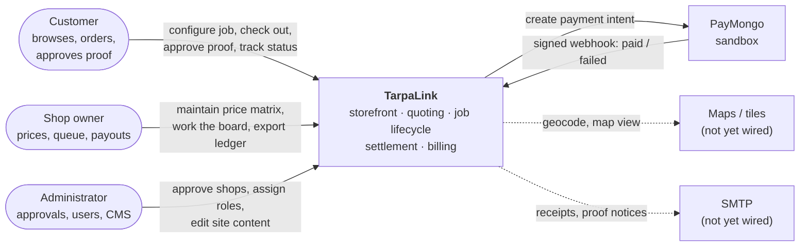
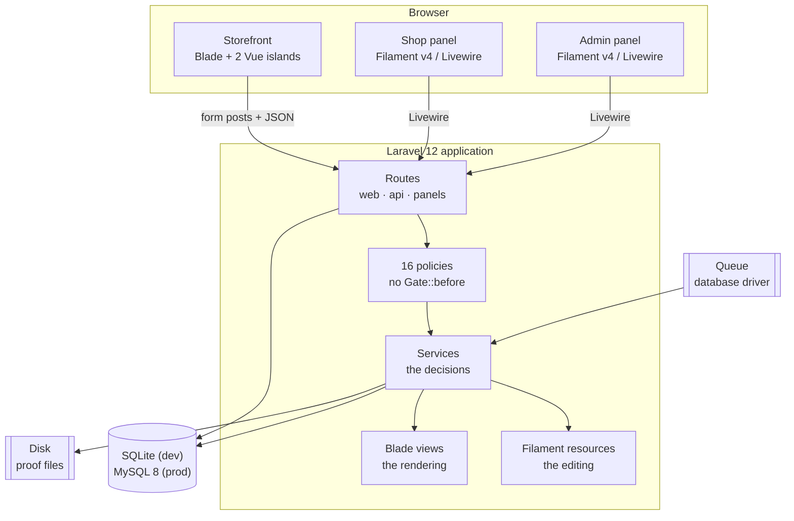
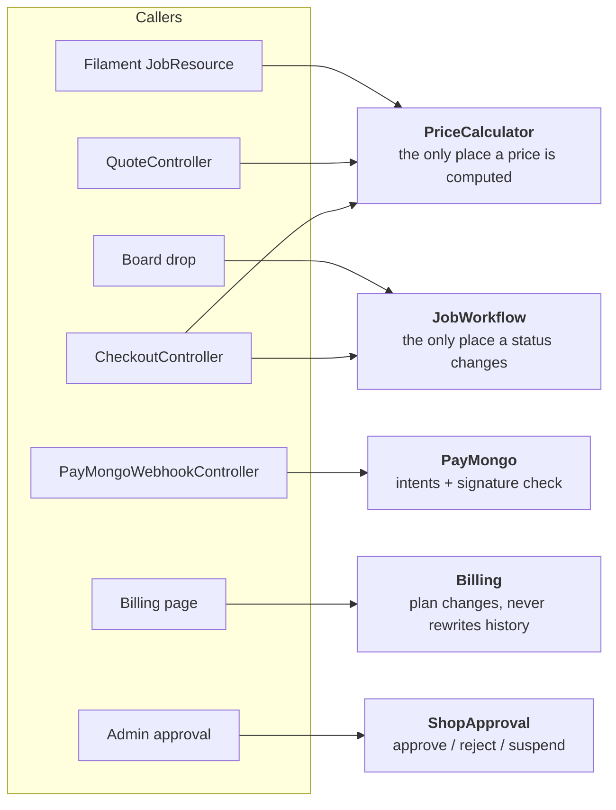
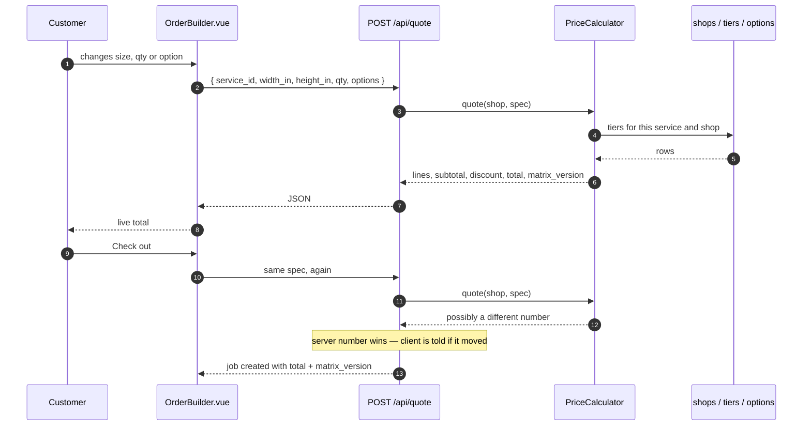
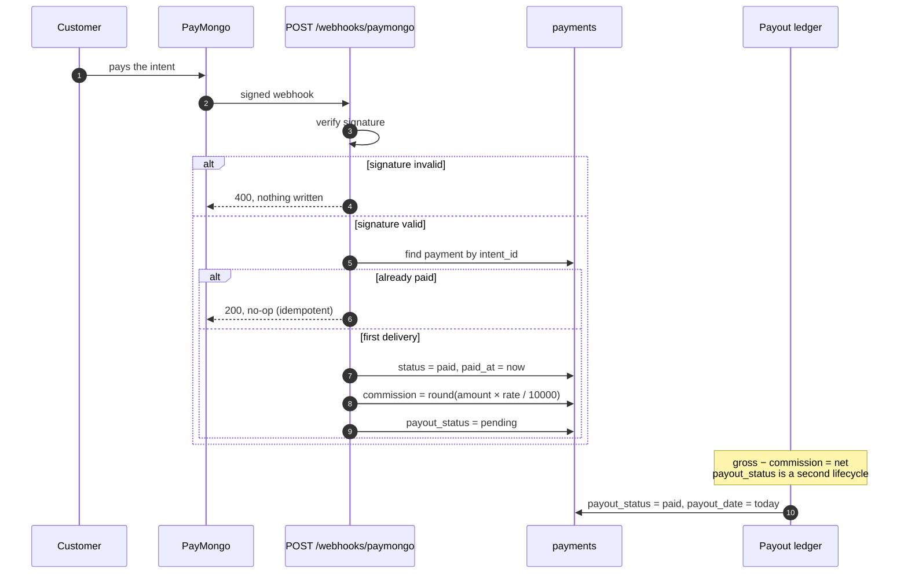
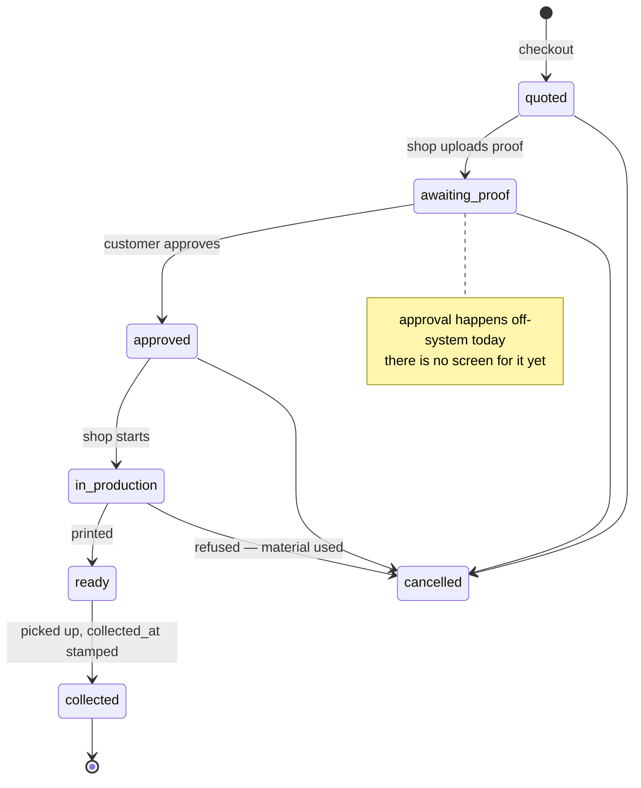
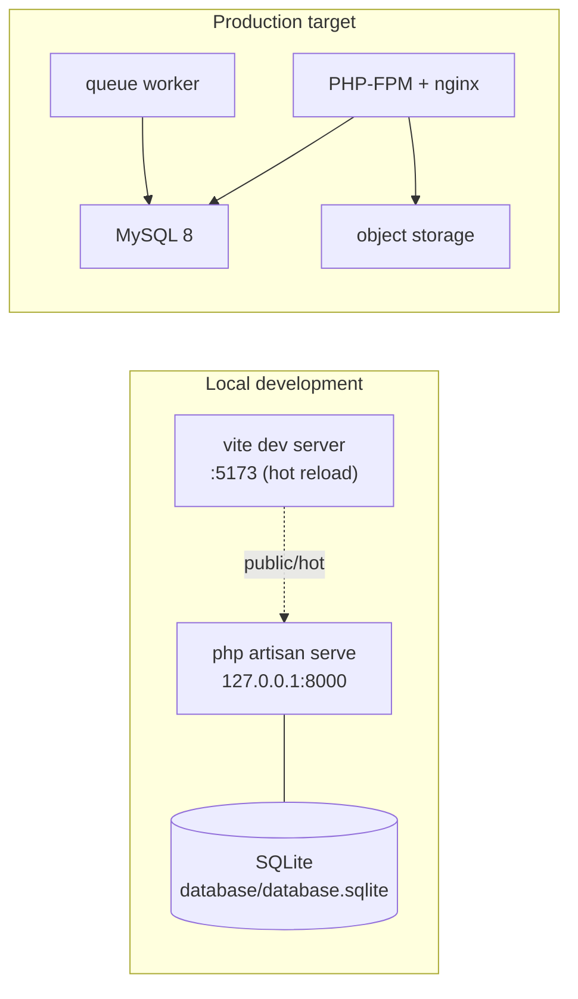

# Architecture — TarpaLink

**How the system is put together, and why it is put together that way.**

The one-line version: **Vue renders, Filament edits, Laravel decides.** Every diagram
below is an elaboration of that sentence.

---

## 1. System context

Who uses TarpaLink, and what crosses the boundary.

Dotted edges are designed for but **not implemented** — they are drawn so the gap is
visible rather than discovered during a demo.

---

## 2. Containers

One Laravel application serving three surfaces. The split is by *audience*, not by
service: a customer never loads Filament, and a shop owner never loads the storefront
bundle.

**Why one application and not three services.** The three surfaces share one price
engine, one lifecycle and one set of tables. Splitting them would mean either duplicating
`PriceCalculator` — the exact failure BR-5 exists to prevent — or turning a single
in-process call into a network call for no benefit at this scale.

**Why Filament on two surfaces and Blade on the third.** Filament is an admin toolkit: it
is excellent at "list these rows, edit this one, gate it by policy", and it is the wrong
tool for a public page that must look like a print shop rather than a database client.
The storefront is hand-written Blade for that reason.

---

## 3. The spine: five services

Everything that could be decided in two places is decided in one.

| Service | Owns | Never does |
|---|---|---|
| `PriceCalculator` | tier lookup, area vs piece multiplication, quantity discounts, matrix version | touch a job or a payment |
| `JobWorkflow` | legal transitions, activity log, `collected_at` | compute a price |
| `PayMongo` | intent creation, webhook signature, failure marking | decide what a job is worth |
| `Billing` | plan change, commission rate update, invoice issue | rewrite a settled payment |
| `ShopApproval` | status, reason, acting user | delete a shop's data |

---

## 4. Runtime behaviour

### 4.1 Quoting — the number on screen and the number in the database

The builder asks on every change. The server answers. The checkout asks again, and the
server's answer is the one that becomes a job.

`matrix_version` is a `crc32 % 10000` fingerprint of the tier rows. It is stored on the
**job**, not the line, because the whole job was priced against one version of the matrix.
If the shop raises a price tomorrow, yesterday's job still shows what was agreed.

### 4.2 Settlement — two independent facts

The mistake this design avoids: treating "the customer paid" and "we paid the shop" as one
field. They happen days apart and one can fail without the other.

Commission is written as an **absolute centavo amount** at settlement time. That single
decision is what makes FR-67 possible: a plan change updates `shops.commission_rate`, and
no settled row reads that column again.

### 4.3 The job lifecycle

`cancelled` is reachable from the first three states only. Once the press has run, the
money is spent and the honest answer is "no", not a refund policy the system cannot
enforce.

---

## 5. Data model

Seventeen domain tables. The entity-relationship diagram, the full dictionary and the
invariants live in [SCHEMA.md](SCHEMA.md) — kept separate because the diagram changes
when the schema changes, and this document should not.

Three relationships carry most of the meaning:

- `shops 1─* services 1─* price_tiers` — a shop's price matrix. Every price in the system
  comes from here.
- `jobs 1─* job_lines` — the priced lines frozen at checkout.
- `jobs 1─1 payments` — one payment per job, with **two** statuses: did the customer pay,
  and did we pay the shop.

---

## 6. Deployment

`public/hot` is the switch. Present → assets come from Vite with hot reload. Absent →
assets come from `public/build` with a manifest. It is gitignored, which is why a fresh
clone must run `npm run build` before anything looks right.

---

## 7. Decisions worth defending

| Decision | Alternative rejected | Why |
|---|---|---|
| **Blade + Vue islands** | SPA, or Inertia | The landing page and directory ship **no JavaScript**. A router would make every page pay for the one interactive screen. |
| **Filament only for admin and shop** | Filament everywhere | Filament cannot be made to look like a print shop's storefront without fighting it. |
| **Integer centavos + basis points** | decimals, floats | `₱0.1 + ₱0.2` is not `₱0.3`. Money that is stored as a float is money that will disagree with itself. |
| **`matrix_version` on the job** | recompute on read | A price the customer agreed to must not change because the shop raised its rates. |
| **Commission as an absolute amount per payment** | compute from current rate | Otherwise a plan upgrade silently rewrites last month's payouts. |
| **Two statuses on `payments`** | one status | Customer payment and shop payout fail independently and days apart. |
| **16 explicit policies, no `Gate::before`** | admin bypass | "Admins can do everything" is how an admin accidentally reads another shop's ledger. |
| **404 for another tenant's record** | 403 | A 403 confirms the record exists. A 404 does not. |
| **Server recomputes at checkout** | trust the client | The client is a convenience; the server is the authority (BR-8). |
| **One service per decision** | fat controllers | A rule that exists in two places is a rule that will disagree with itself. |

---

## 8. What is deliberately missing

- **No API layer for a mobile client.** `POST /api/quote` and the two profile endpoints
  are the only JSON surfaces; they exist because a Vue island needs them, not because an
  API was designed first.
- **No event sourcing.** `job_activities` is an audit log, not a source of truth.
- **No microservices, no cache tier, no search engine.** At seven shops and a few hundred
  jobs, every one of those would be a cost with no measurable benefit.
