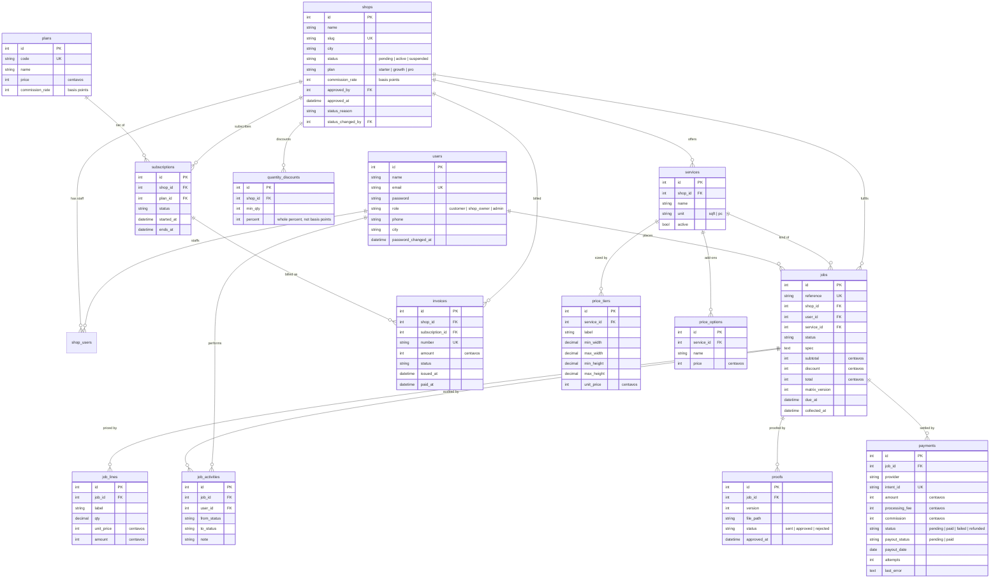

# Data model — TarpaLink

Seventeen domain tables, sixteen Eloquent models (`shop_users` is a pivot with no model of
its own), sixteen policies — one per model.

> **Written against:** `main` plus the profile island (#16). One column shown here,
> `jobs.collected_at`, arrives with the shop-dashboard branch (#17) and is marked where it
> appears; everything else is migrated in this repository today.

---

## 1. Entity relationships



---

## 2. Table dictionary

### 2.1 `users`

| Column | Type | Notes |
|---|---|---|
| `id` | integer PK | |
| `name` | string | |
| `email` | string, unique | Login identity. Uniqueness is re-checked on profile save, ignoring the current user. |
| `password` | string | Bcrypt hash. |
| `role` | string | `customer` · `shop_owner` · `admin`. Exactly one per user. |
| `phone`, `city` | string, nullable | Profile fields; `city` is the default pickup area. |
| `password_changed_at` | timestamp, nullable | Drives "Last changed …" on the profile screen. Null means never. |

The role answers "which panel may this person open". It does **not** answer "which shop" —
that is `shop_users`. A `shop_owner` with no `shop_users` row can open `/shop` and see
nothing, which is the correct outcome.

### 2.2 `shops`

| Column | Type | Notes |
|---|---|---|
| `id` | integer PK | |
| `name`, `slug` | string | `slug` is unique and used in URLs. |
| `city`, `address` | string | |
| `lat`, `lng` | numeric, nullable | Seeded; no live geocoding yet. |
| `accent` | string | The shop's colour, used on its storefront card. |
| `status` | string | `pending` · `active` · `suspended`. Default `pending`. |
| `status_reason` | text, nullable | Why it was rejected or suspended. |
| `approved_at`, `approved_by` | timestamp / FK | Who let it in, and when. |
| `status_changed_by` | FK | Who last moved the status. |
| `plan` | string | `starter` · `growth` · `pro`. |
| `commission_rate` | integer | **Basis points.** `300` = 3%. Read at settlement, never at payout. |
| `rating`, `jobs_done` | numeric / integer | Denormalised counters for the directory. |
| `accepts_rush` | boolean | |

One status column covers both rejection and suspension, because both mean "cannot operate"
and both need a reason. The history of *who* changed it lives in `status_changed_by` plus
`job_activities`-style auditing at the approval service.

### 2.3 `shop_users`

Pivot. `shop_id`, `user_id`, `role` (`owner` · `staff`). A user may belong to several
shops; a shop may have several staff. `currentShop()` resolves the active one.

### 2.4 `services`

| Column | Type | Notes |
|---|---|---|
| `shop_id` | FK | Prices are per shop. There is no global service. |
| `name`, `slug` | string | Slug is unique **within** the shop. |
| `unit` | string | `sqft` → unit price is per square foot. `pc` → per piece. This single column changes the multiplication in `PriceCalculator`. |
| `blurb`, `sort` | string / integer | Storefront copy and ordering. |
| `active` | boolean | Inactive services stay in the database for old jobs but disappear from the builder. |

### 2.5 `price_tiers`

The price matrix. One row per size band per service.

| Column | Type | Notes |
|---|---|---|
| `service_id` | FK | |
| `label` | string | Human name, e.g. "3×3 ft". |
| `min_width` … `max_height` | numeric | The band, in inches. A request must fall inside **one** band; outside every band is an error, not a fallback. |
| `unit_price` | integer | Centavos. Per sq ft or per piece, according to `services.unit`. |

### 2.6 `price_options`

Flat-priced add-ons: eyelets, hemming, rush. `name`, `unit` (per piece / per job),
`price` in centavos.

### 2.7 `quantity_discounts`

`shop_id`, `min_qty`, `percent`. The percent here is a **whole percent** (`10` = 10% off),
not basis points — the discount is computed as `round(subtotal × percent / 100)`. It is
the one rate in the schema that is not in basis points, and it is worth remembering when
reading a payout row next to a discount row.

### 2.8 `jobs`

| Column | Type | Notes |
|---|---|---|
| `reference` | string, unique | Human-facing, e.g. `TL-33909`. |
| `shop_id`, `user_id`, `service_id` | FK | Who prints it, who ordered it, what kind of work. |
| `status` | string | `quoted` · `awaiting_proof` · `approved` · `in_production` · `ready` · `collected` · `cancelled`. |
| `spec` | text | JSON: width, height, quantity, option ids. |
| `subtotal`, `discount`, `total` | integer | Centavos, frozen at checkout. |
| `matrix_version` | integer | Fingerprint of the tier rows used. Stored on the job because the whole job was priced against one version. |
| `pickup_city`, `notes` | string / text | |
| `due_at` | timestamp | Promised date. On-time rate compares `collected_at` to this. |
| `collected_at` | timestamp, nullable | Stamped **only** by `JobWorkflow` on the `→ collected` transition. Arrives with #17. |

### 2.9 `job_lines`

The frozen breakdown: `label`, `qty`, `unit_price`, `amount`, all centavos except `qty`
(which may be fractional for square footage). `SUM(amount)` over a job must equal
`jobs.total` — this is asserted, not assumed.

### 2.10 `proofs`

`job_id`, `version`, `file_path`, `status` (`sent` · `approved` · `rejected`), `note`,
`approved_at`. A job may accumulate several proofs; `(job_id, version)` is unique, so a
re-upload increments the version rather than overwriting the artwork the customer already
looked at.

### 2.11 `payments`

The most important table to understand, because it carries **two lifecycles**.

| Column | Type | Notes |
|---|---|---|
| `job_id` | FK | |
| `provider` | string | `paymongo`. |
| `intent_id` | string, unique | The idempotency key. A replayed webhook finds this row and stops. |
| `amount` | integer | What the customer paid, centavos. |
| `processing_fee` | integer | What the processor kept. |
| `commission` | integer | What the platform kept — **an absolute amount**, written at settlement. |
| `status` | string | Did the **customer** pay: `pending` · `paid` · `failed` · `refunded`. |
| `payout_status` | string | Did **we** pay the shop: `pending` · `paid`. |
| `payout_date` | date, nullable | |
| `attempts`, `last_error`, `failed_at` | integer / text / timestamp | Failure tracking; three attempts flags the row for the admin dashboard. |

Net to the shop = `amount − processing_fee − commission`. The ledger's totals are checked
against a plain `SUM()` over these columns, not against the ledger's own arithmetic.

### 2.12 `job_activities`

`job_id`, `user_id`, `from_status`, `to_status`, `note`. One row per transition, written by
`JobWorkflow` and by nothing else. This is an audit log, not an event store.

### 2.13 `plans` / `subscriptions` / `invoices`

| Table | Key columns |
|---|---|
| `plans` | `code` (`starter` · `growth` · `pro`), `name`, `price` (centavos), `commission_rate` (basis points), `features` (JSON), `sort` |
| `subscriptions` | `shop_id`, `plan_id`, `status`, `started_at`, `ends_at` |
| `invoices` | `shop_id`, `subscription_id`, `number` (unique), `amount`, `status`, `issued_at`, `paid_at` |

A plan change updates `shops.plan` and `shops.commission_rate` and issues an invoice. It
does not touch `payments`. That is the whole point of storing commission per payment.

### 2.14 `page_sections` / `site_settings`

| Table | Key columns |
|---|---|
| `page_sections` | `key`, `label`, `content` (JSON, shaped per key), `status` (`visible` · `hidden`), `sort` |
| `site_settings` | `key`, `value` |

The CMS owns **words, not layout**: a section's content is a shaped JSON blob chosen by
its key, so testimonials get a repeater and the hero gets a headline plus a link. Hiding
or deleting a section removes the block from the page instead of leaving a hole.

---

## 3. Enumerations

| Column | Values |
|---|---|
| `users.role` | `customer`, `shop_owner`, `admin` |
| `shops.status` | `pending`, `active`, `suspended` |
| `shops.plan` | `starter`, `growth`, `pro` |
| `services.unit` | `sqft`, `pc` |
| `jobs.status` | `quoted`, `awaiting_proof`, `approved`, `in_production`, `ready`, `collected`, `cancelled` |
| `proofs.status` | `pending`, `approved`, `rejected` |
| `payments.status` | `pending`, `paid`, `failed`, `refunded` |
| `payments.payout_status` | `pending`, `paid` |
| `page_sections.status` | `visible`, `hidden` |

---

## 4. Invariants

These hold after every request. If one of them is false, there is a bug.

1. **`SUM(job_lines.amount) = jobs.total`** for every job.
2. **`jobs.total = subtotal − discount`**, and `discount ≥ 0`, `total ≥ 0`.
3. **`jobs.matrix_version` matches the tier rows that produced the price**, or the price
   was edited afterwards — in which case the job keeps its old number on purpose.
4. **`payments.intent_id` is unique**, so a replayed webhook cannot double-count.
5. **A `paid` payment has a non-null `paid_at` and a non-null `commission`.**
6. **`payout_status = paid` implies `status = paid`** — we cannot have paid a shop for
   money we never received.
7. **`jobs.collected_at` is non-null exactly when `status = collected`**, and it is set by
   `JobWorkflow` and nothing else.
8. **Every `job_activities` row names a transition that `TRANSITIONS` allows.**
9. **No row in `payments` is ever updated after `payout_status = paid`** — not by a plan
   change, not by a rate edit, not by a migration.

---

## 5. Indexes and constraints

| Table | Index | Why |
|---|---|---|
| `users` | unique `email` | Login identity, and the duplicate check on profile save. |
| `shops` | unique `slug`; index `city`; index `status` | URLs, the directory filter, and the approved-only listing. |
| `shop_users` | unique (`shop_id`, `user_id`) | Resolving a user's current shop on every shop-panel request; also stops a duplicate membership row. |
| `services` | unique (`shop_id`, `slug`) | Two shops may both have "tarpaulin"; one shop may not have two. |
| `jobs` | unique `reference`; index `status`; FK indexes on `shop_id` / `user_id` | Reference lookup, board queries, customer list. |
| `proofs` | unique (`job_id`, `version`) | A re-upload is a new version, not an overwrite. |
| `payments` | unique `intent_id`; index `status`; index `payout_status` | Idempotency, and the "needs attention" and "unpaid out" queries. |
| `job_activities` | index (`job_id`, `created_at`) | The timeline on the job page. |
| `page_sections`, `site_settings` | unique `key` | One row per key; hiding a section is a status, not a second row. |
| `invoices` | unique `number` | Invoice numbering. |

Foreign keys cascade on delete throughout: deleting a shop removes its services, tiers,
jobs, payments and activities. That is the right default for a tenant and the wrong
default for a ledger.

`ShopPolicy::delete` returns `$user->isAdmin()`, so an administrator *can* delete a shop —
and the cascade takes its financial history with it. There is no `SoftDeletes` anywhere in
the model layer. The correct fix is `restrictOnDelete` on `payments` plus soft deletes on
`shops`; the intended operating rule is that a shop is **suspended, never deleted**
(`ShopApproval::suspend`). Recorded here rather than hidden, because a cascade that can
reach a settled payment is exactly the kind of thing that is discovered late.

---

## 6. Money, in one place

Every amount in this schema is an integer number of **centavos**. Every rate is an integer
number of **basis points**. No decimal column exists in a domain table, and no amount is
*stored* as a float.

```
display     : ₱2,036.80
stored      : 203680
rate        : 300            (3.00%)
commission  : (int) round(amount * rate / 10000)
```

The division in that one expression is the only place a float appears in the money path,
and the `(int) round(...)` immediately collapses it back to an exact centavo count before
anything is written. Formatting happens once, in the view, from the integer.

A `round()` applied *after* values have been summed is how a ledger ends up one centavo
short of itself; rounding each payment once, at the moment it is created, is what keeps
`SUM(commission)` equal to the commissions that were actually charged.
