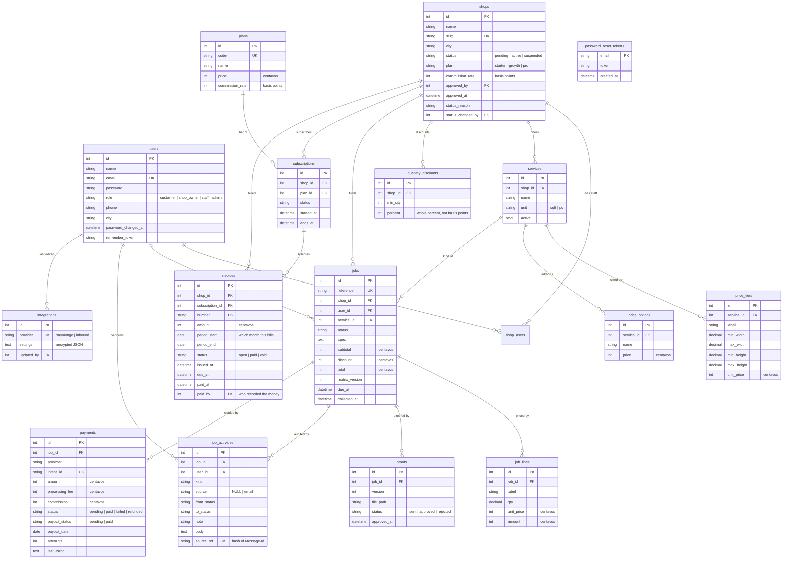

# Data model — TarpaLink

Nineteen domain tables, eighteen Eloquent models (`shop_users` is a pivot with no model of
its own), sixteen policies — one per model that a panel can address. `Integration` has none
on purpose: credentials are reached through `/admin/integrations`, which is gated by panel
access, and a resource with a list page would put every stored key one click from a table.

> **Written against:** current `main`. The model has been stable since #17; #61 added the
> `RESTRICT` foreign keys that protect settled money, #63 added `integrations` plus the
> three inbound-mail columns on `job_activities`, and #73 added `shop_requests`. Everything
> shown here is migrated in this repository today.

---

## 1. Entity relationships



---

## 2. Table dictionary

### 2.1 `users`

| Column | Type | Notes |
|---|---|---|
| `id` | integer PK | |
| `name` | string | |
| `email` | string, unique | Login identity. Uniqueness is re-checked on profile save, ignoring the current user. |
| `password` | string | Bcrypt hash. |
| `role` | string | `customer` · `shop_owner` · `staff` · `admin`. Exactly one per user. |
| `phone`, `city` | string, nullable | Profile fields; `city` is the default pickup area. |
| `password_changed_at` | timestamp, nullable | Drives "Last changed …" on the profile screen. Null means never. |
| `remember_token` | string, nullable | Rewritten on every password reset, so a "remember me" cookie issued before the reset stops working. |

The role answers "which panel may this person open". It does **not** answer "which shop" —
that is `shop_users`. A `shop_owner` with no `shop_users` row can open `/shop` and see
nothing, which is the correct outcome.

`password_reset_tokens` is Laravel's own single-use table, keyed by email. It is written by
`Password::sendResetLink()` and consumed by `Password::reset()`; nothing in this codebase
reads or writes it directly.

### 2.2 `shops`

| Column | Type | Notes |
|---|---|---|
| `id` | integer PK | |
| `name`, `slug` | string | `slug` is unique and used in URLs. |
| `city`, `address` | string | |
| `lat`, `lng` | numeric, nullable | Seeded, and editable from the admin shop form — which can also fill them from a typed address via `Geocoder`. |
| `accent` | string | The shop's colour, used on its storefront card. |
| `status` | string | `pending` · `active` · `suspended`. Default `pending`. |
| `status_reason` | text, nullable | Why it was rejected or suspended. |
| `approved_at`, `approved_by` | timestamp / FK | Who let it in, and when. |
| `status_changed_by` | FK | Who last moved the status. |
| `plan` | string | `starter` · `growth` · `pro`. |
| `commission_rate` | integer | **Basis points.** `300` = 3%. Read at settlement, never at payout. |
| `rating`, `jobs_done` | numeric / integer | Denormalised counters for the directory. |
| `accepts_rush` | boolean | |

One status column covers both rejection and suspension, because both mean "cannot operate"
and both need a reason. The history of *who* changed it lives in `status_changed_by` plus
`job_activities`-style auditing at the approval service.

### 2.3 `shop_users`

Pivot. `shop_id`, `user_id`, `role` (`owner` · `staff`). A user may belong to several
shops; a shop may have several staff. `currentShop()` resolves the active one.

### 2.4 `services`

| Column | Type | Notes |
|---|---|---|
| `shop_id` | FK | Prices are per shop. There is no global service. |
| `name`, `slug` | string | Slug is unique **within** the shop. |
| `unit` | string | `sqft` → unit price is per square foot. `pc` → per piece. This single column changes the multiplication in `PriceCalculator`. |
| `blurb`, `sort` | string / integer | Storefront copy and ordering. |
| `active` | boolean | Inactive services stay in the database for old jobs but disappear from the builder. |

### 2.5 `price_tiers`

The price matrix. One row per size band per service.

| Column | Type | Notes |
|---|---|---|
| `service_id` | FK | |
| `label` | string | Human name, e.g. "3×3 ft". |
| `min_width` … `max_height` | numeric | The band, in inches. A request must fall inside **one** band; outside every band is an error, not a fallback. |
| `unit_price` | integer | Centavos. Per sq ft or per piece, according to `services.unit`. |

### 2.6 `price_options`

Flat-priced add-ons: eyelets, hemming, rush. `name`, `unit` (per piece / per job),
`price` in centavos.

### 2.7 `quantity_discounts`

`shop_id`, `min_qty`, `percent`. The percent here is a **whole percent** (`10` = 10% off),
not basis points — the discount is computed as `round(subtotal × percent / 100)`. It is
the one rate in the schema that is not in basis points, and it is worth remembering when
reading a payout row next to a discount row.

### 2.8 `jobs`

| Column | Type | Notes |
|---|---|---|
| `reference` | string, unique | Human-facing, e.g. `TL-33909`. |
| `shop_id`, `user_id`, `service_id` | FK | Who prints it, who ordered it, what kind of work. |
| `status` | string | `quoted` · `awaiting_proof` · `approved` · `in_production` · `ready` · `collected` · `cancelled`. |
| `spec` | text | JSON: width, height, quantity, option ids. |
| `subtotal`, `discount`, `total` | integer | Centavos, frozen at checkout. |
| `matrix_version` | integer | Fingerprint of the tier rows used. Stored on the job because the whole job was priced against one version. |
| `pickup_city`, `notes` | string / text | |
| `due_at` | timestamp | Promised date. On-time rate compares `collected_at` to this. |
| `collected_at` | timestamp, nullable | Stamped **only** by `JobWorkflow` on the `→ collected` transition. Arrives with #17. |

### 2.9 `job_lines`

The frozen breakdown: `label`, `qty`, `unit_price`, `amount`, all centavos except `qty`
(which may be fractional for square footage). `SUM(amount)` over a job must equal
`jobs.total` — this is asserted, not assumed.

### 2.10 `proofs`

`job_id`, `version`, `file_path`, `status` (`sent` · `approved` · `rejected`), `note`,
`approved_at`. A job may accumulate several proofs; `(job_id, version)` is unique, so a
re-upload increments the version rather than overwriting the artwork the customer already
looked at.

### 2.10a `artworks`

The opposite direction to `proofs`: the file the **customer** sends the shop to print.
`job_id`, `uploaded_by` (nullable, `nullOnDelete`), `file_path`, `original_name`, `mime`,
`bytes`, timestamps.

Rows are append-only. A customer who sends the wrong file, or a revised one, adds another
row rather than replacing the first — what the shop received, and when, is the record, and
overwriting it would lose the answer to "which file did you actually send me?". The newest
row by `id` is the current artwork (`Job::latestArtwork()`), which is why the index is
`(job_id, id)` and not `(job_id, created_at)`: two uploads a second apart are normal.

Separate from `proofs` rather than a `direction` column on one table, because the two have
different authors, different permissions and different lifetimes — an artwork is kept so a
reprint is possible, a proof is kept so the shop can show what was approved.

### 2.11 `payments`

The most important table to understand, because it carries **two lifecycles**.

| Column | Type | Notes |
|---|---|---|
| `job_id` | FK | |
| `provider` | string | `paymongo`. |
| `intent_id` | string, unique | The idempotency key. A replayed webhook finds this row and stops. |
| `amount` | integer | What the customer paid, centavos. |
| `refunded_amount` | integer | How much of `amount` has gone back, cumulatively. 0 until a refund. |
| `processing_fee` | integer | What the processor kept. The **shop** bears it: it comes off the payout, like commission. |
| `commission` | integer | What the platform kept — **an absolute amount**, written at settlement. |
| `commission_refunded` | integer | The part of `commission` given back with the refunds. Stored, not derived, for the same reason `commission` is. |
| `status` | string | Did the **customer** pay: `pending` · `paid` · `failed` · `refunded`. `refunded` means the whole amount went back; a partial refund leaves this at `paid`. |
| `payout_status` | string | Did **we** pay the shop: `pending` · `paid`. |
| `refunded_at` | timestamp, nullable | When the most recent refund was recorded. |
| `payout_date` | date, nullable | |
| `attempts`, `last_error`, `failed_at` | integer / text / timestamp | Failure tracking; three attempts flags the row for the admin dashboard. |

Net to the shop = `(amount − refunded_amount) − (commission − commission_refunded) − processing_fee`.
The ledger's totals are checked against a plain `SUM()` over these columns, not against the
ledger's own arithmetic.

Because both deductions live on this row, the subtraction is written once — `Payment::net()`,
and `Payment::netFrom()` for the payout CSV, which streams flat rows through a cursor and
never builds a model. The reports screen, the export and every per-payment figure go through
those two.

**A refund is an accumulation, not an edit** (BR-4). `refunded_amount` grows and
`commission_refunded` grows with it, so the amounts the payment was settled at are never
rewritten. The commission reverses in proportion — computed as a cumulative target rather
than a per-refund slice, so three thirds of a payment reverse the whole commission and not
99.8% of it.

**The platform's revenue is the commission alone.** It receives the gross, pays the shop the
net, and never pays the processor — so `commission − fee` is not the margin, it is the
arithmetic of an option that was rejected. On a **refund** the commission comes back but the
fee does not, which is why a fully refunded payment nets the shop a small negative and the
row has to stay in the ledger rather than dropping out of it.

### 2.12 `job_activities`

`job_id`, `user_id`, `kind`, `source`, `from_status`, `to_status`, `note`, `body`,
`source_ref`. One row per event on a job. A `kind = transition` row is written by
`JobWorkflow` and by nothing else, and always names a move the `TRANSITIONS` table allows.
A `kind = note` row records that something was said about the job — a nudge, a remark — and
carries no statuses, so the trail can never claim a move that did not happen. This is an
audit log, not an event store.

`source = email` marks a note that arrived as a reply rather than being typed into the
panel. It is a source, not a third kind: an emailed reply still moved nothing, so reports
that count transitions do not have to know mail exists. `note` stays the one-line heading
("Reply by email from Jomar Mendoza"); `body` holds the message itself, because a customer
does not write in 255 characters. `source_ref` is a hash of the provider's `Message-Id` —
or of the message content when there is none — under a unique index, so a provider retry
cannot file the same reply twice.

### 2.13 `plans` / `subscriptions` / `invoices`

| Table | Key columns |
|---|---|
| `plans` | `code` (`starter` · `growth` · `pro`), `name`, `price` (centavos), `commission_rate` (basis points), `features` (JSON), `sort` |
| `subscriptions` | `shop_id`, `plan_id`, `status`, `started_at`, `ends_at` |
| `invoices` | `shop_id`, `subscription_id`, `number` (unique), `amount`, `period_start`, `period_end`, `status`, `issued_at`, `due_at`, `paid_at`, `paid_by` |

A plan change updates `shops.plan` and `shops.commission_rate` and issues an invoice. It
does not touch `payments`. That is the whole point of storing commission per payment.

**`period_start` is what makes recurring billing answerable.** Without it, "does this shop
already have this month's invoice?" cannot be asked, so a nightly command either duplicates
or skips. Periods follow the day the subscription started, and the issuing command is
idempotent because it checks the period rather than the clock.

**`status` has three values and overdue is not one of them.** `open` · `paid` · `void`.
Overdue is `open` plus a past `due_at`, computed in `Invoice::isOverdue()` — a stored
`overdue` would need a nightly job to stay true and would be wrong every night between the
deadline and the run.

**A switch mid-period voids the bill it supersedes.** Otherwise the shop is collectable
twice for the same month, once for the plan it left and once for the plan it joined, and the
first invoice stays `open` forever because nobody will ever pay it. Only the month the switch
lands in is voided: an unpaid invoice from an earlier month is arrears, and upgrading does
not erase arrears.

`paid_by` exists because a subscription invoice is settled by GCash or a bank transfer, not by
a card we hold. "Paid" is a person's claim, so it carries their name.

### 2.14 `page_sections` / `site_settings`

| Table | Key columns |
|---|---|
| `page_sections` | `key`, `label`, `content` (JSON, shaped per key), `status` (`visible` · `hidden`), `sort` |
| `site_settings` | `key`, `value` |

The CMS owns **words, not layout**: a section's content is a shaped JSON blob chosen by
its key, so testimonials get a repeater and the hero gets a headline plus a link. Hiding
or deleting a section removes the block from the page instead of leaving a hole.

### 2.15 `integrations`

`provider`, `settings` (encrypted JSON), `updated_by`. One row per outside service whose
credentials rotate: `paymongo` and `inbound`.

Deliberately **not** `site_settings`. That table holds public copy and is edited through a
screen that lists every row; putting an API key beside a headline means the next person who
exports the content table exports the keys with it. The blob is encrypted with `APP_KEY`
via `encrypted:array`, so a database dump is not a set of live keys, and `updated_by`
records who last changed one.

`App\Support\Credentials` is the only reader. Database first, environment second, nothing
third — and a blank stored value is dropped on save so the environment fallback re-applies.
That is what makes "leave this field empty" mean *revert*, which is the only reading that
is not ambiguous.

### 2.16 `shop_requests`

A shop asking to be let in. `user_id`, `business_name`, `contact_name`, `email`, `phone`,
`city`, `address`, `services` (free text, one service per line), `message`, `status`,
`reason`, `shop_id`, `handled_by`, `handled_at`.

Deliberately **not** a `shops` row with `status = pending`. A request has no price matrix and
no storefront; creating a half-shop for every enquiry would put unowned rows in the shop list,
in the pending count on the admin dashboard, and in every query that assumes a shop has
somebody who runs it. The request is its own record until an administrator decides, and
`shop_id` links it to what it became.

`user_id` is the account that applied, and it decides which admission shape the request is.
Set — the applicant registered as they applied, chose their own password, and approval only
attaches the shop. Null — the older shape: approval creates the account and hands over a
set-password link. It is `nullOnDelete`, so deleting an account leaves the request behind for
an administrator to see rather than silently erasing it.

`status` is `new` → `approved` | `rejected`, and nothing moves it back: a rejected
application is re-applied for, not reopened, because the details will have changed. A request
carrying a `user_id` is the one case where a `users` row exists before the decision — and it
is created as `shop_owner` while being able to reach nothing, because the console admits only
an account attached to an *active* shop.

---

## 3. Enumerations

| Column | Values |
|---|---|
| `users.role` | `customer`, `shop_owner`, `staff`, `admin` |
| `shops.status` | `pending`, `active`, `suspended` |
| `shops.plan` | `starter`, `growth`, `pro` |
| `services.unit` | `sqft`, `pc` |
| `jobs.status` | `quoted`, `awaiting_proof`, `approved`, `in_production`, `ready`, `collected`, `cancelled` |
| `proofs.status` | `pending`, `approved`, `rejected` |
| `payments.status` | `pending`, `paid`, `failed`, `refunded` |
| `payments.payout_status` | `pending`, `paid` |
| `job_activities.kind` | `transition`, `note` |
| `shop_requests.status` | `new`, `approved`, `rejected` |
| `job_activities.source` | `NULL`, `email` |
| `page_sections.status` | `visible`, `hidden` |

---

## 4. Invariants

These hold after every request. If one of them is false, there is a bug.

1. **`SUM(job_lines.amount) = jobs.total`** for every job.
2. **`jobs.total = subtotal − discount`**, and `discount ≥ 0`, `total ≥ 0`.
3. **`jobs.matrix_version` matches the tier rows that produced the price**, or the price
   was edited afterwards — in which case the job keeps its old number on purpose.
4. **`payments.intent_id` is unique**, so a replayed webhook cannot double-count.
5. **A `paid` payment has a non-null `paid_at` and a non-null `commission`.**
6. **`payout_status = paid` implies `status = paid`** — we cannot have paid a shop for
   money we never received.
7. **`jobs.collected_at` is non-null exactly when `status = collected`**, and it is set by
   `JobWorkflow` and nothing else.
8. **Every `job_activities` row with `kind = transition` names a transition that
   `TRANSITIONS` allows; every row with `kind = note` has both statuses null.** The two
   shapes never mix, so a cycle-time query over `kind = transition` cannot be skewed by a
   nudge.
9. **No row in `payments` is ever updated after `payout_status = paid`** — not by a plan
   change, not by a rate edit, not by a migration.
10. **No payment row is ever removed.** `payments.job_id` is `RESTRICT`, so a job cannot
    be deleted while a payment points at it, and `jobs.shop_id` is `RESTRICT` for the same
    reason one level up. A payment disappears only if somebody drops the table.
11. **No `job_activities` row with `source = email` changes `jobs.status`.** Inbound mail
    is unauthenticated — anyone who learns a reference can send one — so it appends a note
    and nothing else. Approval stays behind the signed-in link on the job page.
12. **`integrations.settings` is never stored in the clear**, and every credential read
    goes through `Credentials`, never `config()` directly. A second reader would be a
    second place the database-over-environment rule could be forgotten.

---

## 5. Indexes and constraints

| Table | Index | Why |
|---|---|---|
| `users` | unique `email` | Login identity, and the duplicate check on profile save. |
| `shops` | unique `slug`; index `city`; index `status` | URLs, the directory filter, and the approved-only listing. |
| `shop_users` | unique (`shop_id`, `user_id`) | Resolving a user's current shop on every shop-panel request; also stops a duplicate membership row. |
| `services` | unique (`shop_id`, `slug`) | Two shops may both have "tarpaulin"; one shop may not have two. |
| `jobs` | unique `reference`; index `status`; FK indexes on `shop_id` / `user_id` | Reference lookup, board queries, customer list. |
| `proofs` | unique (`job_id`, `version`) | A re-upload is a new version, not an overwrite. |
| `payments` | unique `intent_id`; index `status`; index `payout_status` | Idempotency, and the "needs attention" and "unpaid out" queries. |
| `job_activities` | index (`job_id`, `created_at`); unique `source_ref` | The timeline on the job page; and the key that stops a provider retry filing the same reply twice. |
| `integrations` | unique `provider` | One credential blob per service, read on every request that needs a key. |
| `page_sections`, `site_settings` | unique `key` | One row per key; hiding a section is a status, not a second row. |
| `invoices` | unique `number` | Invoice numbering. |

Foreign keys cascade on delete throughout — with two deliberate exceptions. Deleting a
shop removes its services, tiers, jobs, lines, proofs and activities; deleting a job
removes its lines, proofs and activities. That is the right default for a tenant's own
work.

It is the wrong default for money, so `payments.job_id` and `jobs.shop_id` are
**`RESTRICT`**. Both cascades used to end at `payments`, which meant an administrator's
delete could erase every settled payment the ledger and the platform's commission are
computed from, with nothing to warn anybody. The operating rule is that a shop is
**suspended, never deleted** (`ShopApproval::suspend`), and the database now enforces it
rather than trusting everyone to remember it.

The policies agree with the schema, so the panel offers a hidden button rather than a
constraint violation: `ShopPolicy::delete` refuses a shop that still has jobs, and
`UserPolicy::delete` refuses a user whose jobs carry payments. A job with no money on it
still deletes cleanly, which is the case that actually needs deleting. There is still no
`SoftDeletes` anywhere in the model layer; `RESTRICT` is the guarantee, and soft deletes
would be an additional convenience rather than the fix.

---

## 6. Money, in one place

Every amount in this schema is an integer number of **centavos**. Every rate is an integer
number of **basis points**. No decimal column exists in a domain table, and no amount is
*stored* as a float.

```
display     : ₱2,036.80
stored      : 203680
rate        : 300            (3.00%)
commission  : (int) round(amount * rate / 10000)
```

The division in that one expression is the only place a float appears in the money path,
and the `(int) round(...)` immediately collapses it back to an exact centavo count before
anything is written. Formatting happens once, in the view, from the integer.

A `round()` applied *after* values have been summed is how a ledger ends up one centavo
short of itself; rounding each payment once, at the moment it is created, is what keeps
`SUM(commission)` equal to the commissions that were actually charged.
